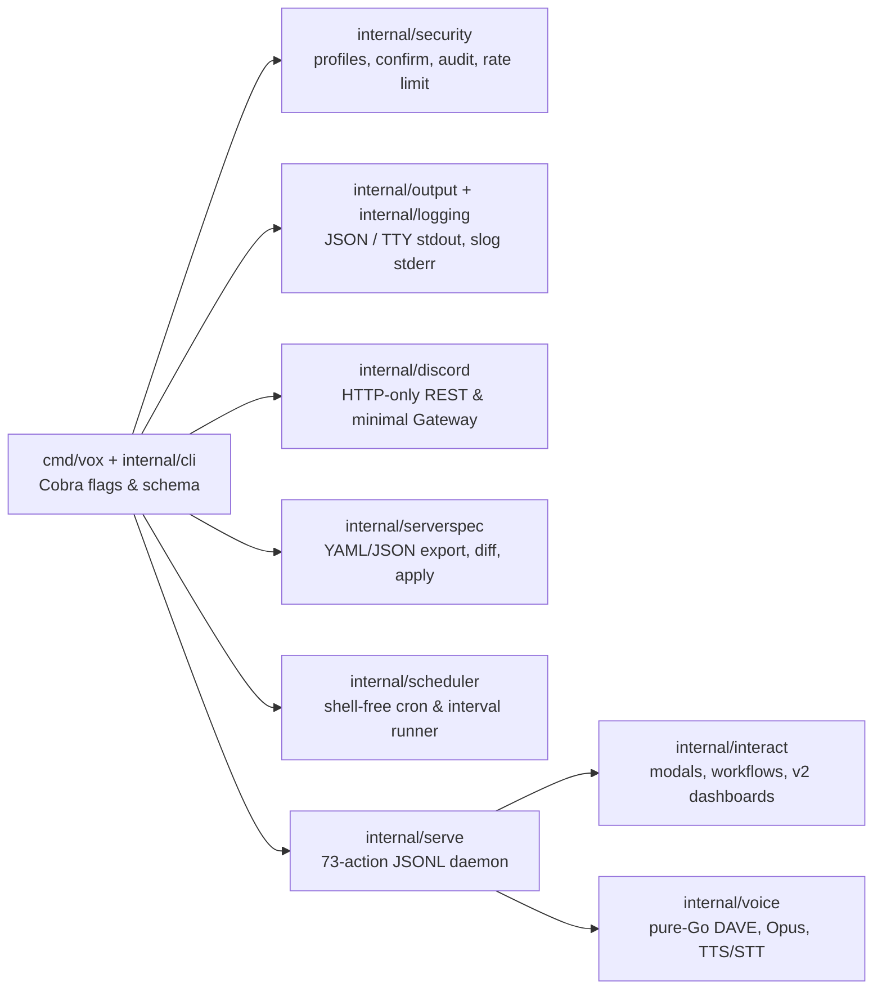

<h1 align="center">vox</h1>

<p align="center">
  <strong>A fast, single-binary Discord CLI built in pure Go for humans and AI agents.</strong>
</p>

<p align="center">
  <a href="https://github.com/cafecito-games/vox/actions/workflows/ci.yml"></a>
  <a href="go.mod"></a>
  <a href="LICENSE"></a>
  <br>
  
  
  
</p>

---

**Talk to Discord from your terminal or drive it programmatically from an AI agent.** Send messages, manage channels and roles, inspect audit logs, reconcile servers as YAML/JSON code, schedule recurring tasks, stream live events, build interactive Components v2 dashboards, and join E2EE voice channels &mdash; all from one static binary with zero runtime dependencies for text features.

## Highlights

- **Human & agent ergonomic** &mdash; Clean plain-text output on TTYs, universal `--json` on every command, compact NDJSON for event streams, and `vox schema --json` so AI agents can introspect every command, flag, exit code, and `serve` action in one call.
- **Strict stdout / stderr separation** &mdash; Command data goes to `stdout`; structured `log/slog` logs (`--log-level`, `--log-format text|json`), notes, and confirmation prompts go strictly to `stderr`.
- **HTTP-first connection model** &mdash; One-shot commands talk directly to Discord's REST API without opening a Gateway session or consuming an `IDENTIFY`. Gateway sessions are reserved for `listen`, `serve`, and live `voice` commands, requesting only the minimal intents required.
- **Built-in guardrails** &mdash; Permission profiles (`full`, `chat`, `readonly`, `moderation`, plus custom profiles), fail-closed destructive confirmations (`--yes`/`-y`), append-only local NDJSON audit log, and moderation rate limiting.
- **Pure-Go Voice + DAVE E2EE** &mdash; Built-in pure-Go Discord DAVE end-to-end encryption and Opus decoding with `CGO_ENABLED=0` across macOS, Linux, and Windows. FFmpeg is only needed at runtime for `voice play` and `voice speak`.
- **Server as Code** &mdash; Export, diff, and apply roles, categories, channels, and role overwrites from portable YAML or JSON specs (`vox server export | diff | apply`).

## Installation

### Homebrew (macOS & Linux)

```sh
brew install --cask cafecito-games/tap/vox
```

### Go Install

```sh
go install github.com/cafecito-games/vox/cmd/vox@latest
```

Prebuilt binaries for macOS (`arm64`, `x86_64`), Linux (`arm64`, `x86_64`), and Windows (`arm64`, `x86_64`) are also published on the [GitHub Releases](https://github.com/cafecito-games/vox/releases) page.

## Quickstart

### Interactive Setup (Humans)

Create a bot application in the [Discord Developer Portal](https://discord.com/developers/applications) and run the guided wizard:

```sh
vox setup
```

`vox setup` validates your token before saving it (`~/.vox/config.json` with `0600` permissions), generates a least-privilege OAuth2 invite URL, lets you choose a permission profile, prints voice provider hints if desired, and runs `vox doctor`. It refuses to run on piped stdin or with `--json` so automated scripts never hang waiting for input.

### Non-Interactive Setup (Scripts & AI Agents)

```sh
vox config set token YOUR_BOT_TOKEN
vox doctor --json
vox doctor --server "My Server" --json
```

`vox doctor --server <name>` inspects your bot's live Discord permission bitfield, including regressions from Discord's 2026 permission splits (`pin_messages`, `bypass_slowmode`, `create_expressions`, `create_events`).

## Everyday Usage

Identifiers accept either names or snowflake IDs (`#general` or `123456789012345678`, `@alice` or her user ID).

```sh
# Messages, embeds, replies, pins, and server-wide search
vox message send "#general" "Deploy complete" --embed-title "v1.4.0" --embed-color 5865F2 --embed-field "Status::Green::true"
vox message reply "#general" 123456789012345678 "Looks good!"
vox message search-server "My Server" "release" --has file --limit 10 --json

# Reactions, threads, polls, webhooks, DMs
vox reaction add "#general" 123456789012345678 "🚀"
vox poll create "#general" "Preferred format?" JSON YAML --duration 12 -e "📦" -e "📝"
vox thread create "#general" 123456789012345678 "Incident Triage"
vox webhook send "#alerts" "CI Bot" "Build green" --username "Release Bot"

# Moderation & community administration
vox member timeout "My Server" "@spammer" 300 --reason "Flooding" --yes
vox automod create "My Server" "Block Links" --trigger keyword --keyword "bad.example" --action block --action alert --alert-channel "#mod-log"
vox invite create "#welcome" --max-age 86400 --max-uses 10
vox emoji upload "My Server" "party" ./party.png

# Server as Code (YAML or JSON)
vox server export "My Server" --out server.yaml
vox server diff "My Server" server.yaml
vox server apply "My Server" server.yaml --dry-run
vox server apply "My Server" server.yaml

# Recurring scheduled commands (shell-free)
vox schedule add standup --time 09:00 --tz America/New_York --action 'message send "#standup" "Good morning! Post your updates."'
vox schedule run
```

## AI Agent Integration

### 1. Self-Describing Schema

Agents can bootstrap their full tool knowledge in a single command without scraping `--help`:

```sh
vox schema --json
```

This outputs every command, subcommand, flag type/default, destructive marker, exit code table, built-in permission profile, and all 73 `vox serve` stdin actions.

### 2. Event Streaming (`vox listen`)

Stream real-time Discord events as compact NDJSON (`--json`) and pipe into any language or shell script:

```sh
vox --json listen --events messages | while read -r event; do
  if [ "$(echo "$event" | jq -r '.mentions_bot')" = "true" ]; then
    channel=$(echo "$event" | jq -r '.channel_id')
    msg=$(echo "$event" | jq -r '.message_id')
    vox message reply "$channel" "$msg" "Hello! How can I help?"
  fi
done
```

### 3. Persistent Bot Daemon (`vox serve`)

For low-latency multi-turn agents, `vox serve` holds one Discord Gateway connection open and speaks bidirectional JSONL over `stdin` / `stdout` with **73 actions** across messaging, token-by-token streaming (`stream_start` / `stream_chunk` / `stream_end` with 1.5 s edit throttling and automatic 2,000-character overflow splitting), slash commands (`--slash-commands`), buttons/selects/modals, threads, polls, channels, roles, webhooks, events, workflows, Components v2 dashboards, and voice:

```sh
vox serve --events messages,reactions --slash-commands ./commands.json
```

```json
{"action": "send", "channel_id": "123456789012345678", "content": "Ready!", "req_id": "1"}
{"action": "stream_start", "channel_id": "123456789012345678", "req_id": "2"}
{"action": "stream_chunk", "stream_id": "a1b2c3d4", "content": "Thinking...", "req_id": "3"}
{"action": "stream_end", "stream_id": "a1b2c3d4", "req_id": "4"}
```

### Exit Codes

| Exit Code | Meaning |
| :---: | --- |
| `0` | Success |
| `1` | Runtime or Discord API error |
| `2` | Usage or validation error |
| `3` | Blocked by active permission profile |

## Security & Permission Profiles

Four built-in profiles restrict what a human or agent invocation may execute (plus custom profiles in `~/.vox/permissions.json`):

| Profile | Capabilities | Destructive Ops |
| --- | --- | :---: |
| `full` | Unrestricted access (default) | Allowed |
| `moderation` | Moderation, messaging, threads, AutoMod, voice, and interactions (no `config set`, `permission set`, or `server apply`) | Allowed |
| `chat` | Messages, reactions, threads, DMs, typing, `listen`, `serve`, `interact`, and read-only server queries | Denied |
| `readonly` | List, info, get, search, audit-log, diff/export, and `listen` only | Denied |

```sh
vox permission set readonly
vox --profile chat message send "#general" "Scoped override for one call"
vox audit show --limit 25 --json
```

Destructive commands (`member kick|ban|unban|timeout`, `channel delete`, `message delete|bulk-delete`, `role delete`, `webhook delete`, `event delete`, `emoji delete`, `invite delete`, `schedule remove`, `automod delete`, `server apply --prune`) fail closed against the active profile before prompting for confirmation (or pass `--yes` / `-y` for non-interactive runs) and log to `~/.vox/audit.log`.

## Voice & Speech

`vox` compiles Discord DAVE E2EE (`dave-go` + `godave`) and Opus decoding (`pion/opus`) directly into the binary with `CGO_ENABLED=0`.

```sh
vox voice where "@alice"
vox voice members "General"
vox voice join "General"
vox voice speak "Deploying now" --channel "General" --voice default
vox voice play ./alert.mp3 --channel "General" --volume 0.8
vox voice listen --channel "General" --duration 60 --json
vox voice capture --channel "General" --duration 10   # raw 48 kHz WAV debug capture
```

Supported providers:
- **TTS**: ElevenLabs (`ELEVENLABS_API_KEY`), OpenAI (`OPENAI_API_KEY`), Deepgram Aura (`DEEPGRAM_API_KEY`)
- **STT**: Deepgram streaming WebSocket (`DEEPGRAM_API_KEY`, `VOX_DEEPGRAM_MODEL`, `VOX_DEEPGRAM_LANGUAGE`), OpenAI Whisper (`OPENAI_API_KEY`)

## Configuration & Environment

Token resolution order:
1. `--token` flag
2. `DISCORD_BOT_TOKEN` environment variable
3. `token` in `~/.vox/config.json` (`0600`)
4. `DISCORD_TOKEN` environment variable

| Variable | Description |
| --- | --- |
| `DISCORD_BOT_TOKEN` | Primary Discord bot token |
| `DISCORD_TOKEN` | Fallback Discord bot token |
| `VOX_CONFIG_DIR` | Override `~/.vox` state directory |
| `VOX_PROFILE` | Override active permission profile |
| `VOX_LOG_LEVEL` | Structured stderr log level (`debug`, `info`, `warn`, `error`) |
| `VOX_LOG_FORMAT` | Structured stderr log format (`text`, `json`) |
| `NO_COLOR` | Disable ANSI colors in human output |

## Architecture



```text
cmd/vox/                 Binary entrypoint & OS signal handling
internal/
├── buildinfo/           Version/commit/date metadata injected via -ldflags
├── cli/                 Thin Cobra command tree + agent `vox schema`
├── config/              Secure ~/.vox storage & token resolution
├── discord/             HTTP-only REST, minimal-intent Gateway, resolvers, embeds
├── doctor/              Offline & live --server diagnostics (incl. 2026 permission splits)
├── interact/            Modals, multi-step workflows, embed & Components v2 dashboards
├── logging/             Structured log/slog configuration (stderr only)
├── output/              Human/JSON/NDJSON writers & typed exit codes
├── scheduler/           Shell-free lexer, IANA timezone wall-clock & interval runner
├── security/            Permission profiles, destructive confirmation, audit log, limiter
├── serve/               Bidirectional stdin/stdout JSONL daemon (73 actions)
├── serverspec/          Declarative YAML/JSON server export, partial diff, apply/prune
├── setup/               Interactive 5-step human onboarding wizard
└── voice/               Pure-Go DAVE/Opus voice engine, FFmpeg player, TTS & STT
```

## Development & Releases

All local checks are orchestrated with [Taskfile.yml](Taskfile.yml):

| Command | Description |
| --- | --- |
| `task check` | Run formatting check, `go vet`, `golangci-lint`, `go test -race ./...`, and `go build` |
| `task fmt` / `task lint` | Format with `gofmt`/`goimports` and lint with `golangci-lint` v2 |
| `task test` | Run all tests with `-race` (`testify` assertions throughout) |
| `task release:snapshot` | Build local cross-platform archives and Homebrew cask via GoReleaser |

Releases are cut from the **Release** GitHub Actions workflow (`workflow_dispatch`), where you choose whether to bump `patch`, `minor`, or `major`. The workflow runs all checks, computes and pushes the next `vX.Y.Z` tag, builds multi-platform archives with GoReleaser, and publishes the Homebrew cask to `cafecito-games/homebrew-tap`.

## License

`vox` is released under the [MIT License](LICENSE).
