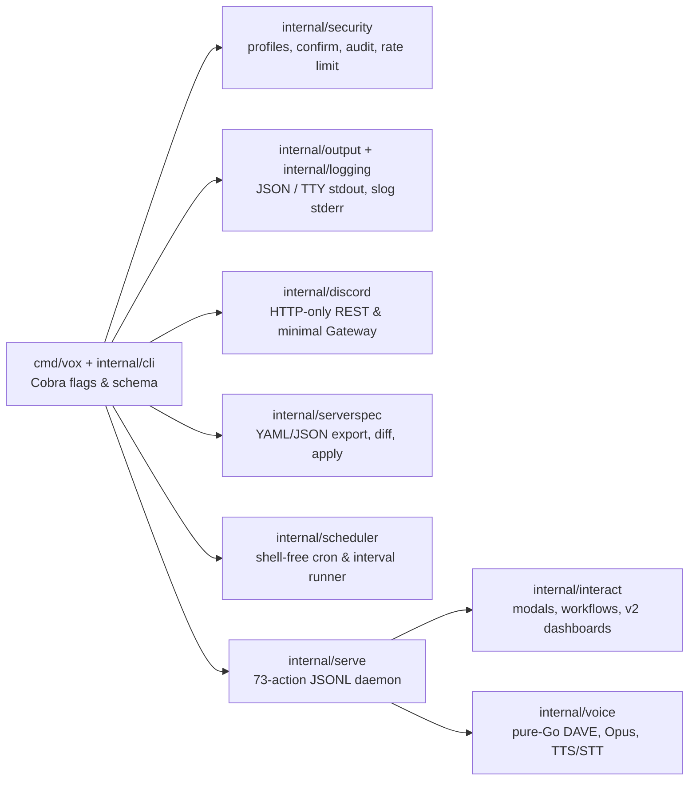

<h1 align="center">vox</h1>

<p align="center">
  <strong>A fast, single-binary Discord CLI built in pure Go for humans and AI agents.</strong>
</p>

<p align="center">
  <a href="https://github.com/cafecito-games/vox/actions/workflows/ci.yml"></a>
  <a href="go.mod"></a>
  <a href="LICENSE"></a>
  <br>
  
  
  
</p>

---

**Talk to Discord from your terminal or drive it programmatically from an AI agent.** Send messages, manage channels and roles, inspect audit logs, reconcile servers as YAML/JSON code, schedule recurring tasks, stream live events, build interactive Components v2 dashboards, and join E2EE voice channels &mdash; all from one static binary with zero runtime dependencies for text features.

## Highlights

- **Human & agent ergonomic** &mdash; Clean plain-text output on TTYs, universal `--json` on every command, compact NDJSON for event streams, and `vox schema --json` so AI agents can introspect every command, flag, exit code, and `serve` action in one call.
- **Strict stdout / stderr separation** &mdash; Command data goes to `stdout`; structured `log/slog` logs (`--log-level`, `--log-format text|json`), notes, and confirmation prompts go strictly to `stderr`.
- **HTTP-first connection model** &mdash; One-shot commands talk directly to Discord's REST API without opening a Gateway session or consuming an `IDENTIFY`. Gateway sessions are reserved for `listen`, `serve`, and live `voice` commands, requesting only the minimal intents required.
- **Built-in guardrails** &mdash; Permission profiles (`full`, `chat`, `readonly`, `moderation`, plus custom profiles), fail-closed destructive confirmations (`--yes`/`-y`), append-only local NDJSON audit log, and moderation rate limiting.
- **Pure-Go Voice + DAVE E2EE** &mdash; Built-in pure-Go Discord DAVE end-to-end encryption and Opus decoding with `CGO_ENABLED=0` across macOS, Linux, and Windows. FFmpeg is only needed at runtime for `voice play` and `voice speak`.
- **Server as Code** &mdash; Export, diff, and apply roles, categories, channels, and role overwrites from portable YAML or JSON specs (`vox server export | diff | apply`).

## Installation

### Homebrew (macOS & Linux)

```sh
brew install --cask cafecito-games/tap/vox
```

### Go Install

```sh
go install github.com/cafecito-games/vox/cmd/vox@latest
```

Prebuilt binaries for macOS (`arm64`, `x86_64`), Linux (`arm64`, `x86_64`), and Windows (`arm64`, `x86_64`) are also published on the [GitHub Releases](https://github.com/cafecito-games/vox/releases) page.

## GitHub Actions

Use `cafecito-games/vox/actions/notify` for a Discord notification and `cafecito-games/vox/actions/setup` to make the Vox CLI available to later steps. Both actions install a checksum-verified Vox release on Linux or macOS runners with X64 or ARM64 architecture, cache the verified binary under `$RUNNER_TOOL_CACHE/vox/<version>/<arch>/vox`, and reuse an existing `VOX_BIN` or `vox` on `PATH` when `vox --version` matches the requested tag. They use the action's release tag by default. Set `vox-version` explicitly when pinning the action to a commit SHA. The notification action reads the webhook from the `DISCORD_WEBHOOK_URL` environment variable and has no `jq` requirement.

Add this notification job to a workflow with a `deploy` job. Replace `vX.Y.Z` with a published Vox release that contains `webhook post`. The step skips an unset webhook secret and treats delivery as best-effort without needing `continue-on-error`.

```yaml
  notify-discord:
    name: Notify Discord
    needs: deploy
    if: always()
    runs-on: ubuntu-latest
    permissions: {}
    steps:
      - name: Post deployment status
        id: discord
        uses: cafecito-games/vox/actions/notify@vX.Y.Z
        env:
          DISCORD_WEBHOOK_URL: ${{ secrets.DISCORD_WEBHOOK_URL }}
        with:
          title: Deployment · ${{ needs.deploy.result }}
          message: ${{ github.workflow }} run #${{ github.run_number }}
          status: ${{ needs.deploy.result }}
          required: false
          fail-on-delivery-error: false
          fields-json: >-
            [
              {"name":"Ref","value":${{ toJSON(github.ref_name) }},"inline":true},
              {"name":"Commit","value":${{ toJSON(github.sha) }},"inline":true}
            ]
```

Use `message` for plain text or add `title`, `status`, `color` (hex RGB, mutually exclusive with `status`), or `fields-json` to create an embed. The action links to the current Actions run by default. Use `payload-file` to send a single Discord JSON payload, a JSON array of payloads, or a JSONL stream, and `thread-id` to target a thread. Set `truncate: true` to clip overlong embeds with an ellipsis and `escape-fields: true` to escape untrusted Discord markdown in field names and values. The action exposes `message-id`, `message-ids` (JSON array), and `delivered` outputs; `actions/setup` exposes `path` and `cache-hit`.

For direct CLI access, use the setup action followed by a shell step. Supply the webhook secret to the posting step.

```yaml
- uses: cafecito-games/vox/actions/setup@vX.Y.Z
- run: vox webhook post --payload-file ./alert.json --file ./report.txt --json
  env:
    DISCORD_WEBHOOK_URL: ${{ secrets.DISCORD_WEBHOOK_URL }}
```

`vox webhook post` accepts text, embed flags, or Discord JSON payloads (single object, JSON array, or JSONL) from a file or stdin (`--payload-file -`). It validates embeds against Discord's limits before sending (with optional `--truncate` and `--escape-fields`), supports `--best-effort` for tolerant delivery and `--output id|github-output` for scripts, uses the webhook credential alone, and waits for Discord to confirm delivery. Mentions are suppressed by default. A JSON payload can opt in using `allowed_mentions`. Use `vox webhook post --help` for the full set of flags.

## Quickstart

### Interactive Setup (Humans)

Create a bot application in the [Discord Developer Portal](https://discord.com/developers/applications) and run the guided wizard:

```sh
vox setup
```

`vox setup` validates your token before saving it (`~/.vox/config.json` with `0600` permissions), generates a least-privilege OAuth2 invite URL, lets you choose a permission profile, prints voice provider hints if desired, and runs `vox doctor`. It refuses to run on piped stdin or with `--json` so automated scripts never hang waiting for input.

### Non-Interactive Setup (Scripts & AI Agents)

Create the application and issue its bot token in Discord, then inject the token as `DISCORD_BOT_TOKEN` from your secret store. [Discord Developer Portal](https://discord.com/developers/applications)

```sh
vox bot show --json
vox bot profile edit --username "Release Bot" --avatar ./avatar.png --json
vox bot application edit --description "Publishes release updates" \
  --tags releases,automation --guild-install-permissions view_channel,send_messages --json
vox bot invite --guild-id "$DISCORD_GUILD_ID" --permissions view_channel,send_messages --json
vox doctor --json
vox doctor --server "My Server" --json
```

Pass `--application-id` to generate an invite offline, or `--bundle` to request one or more of `messaging`, `moderation`, `voice`, and `admin`. With no explicit permissions or bundles, the invite requests zero permission bits. An authorized server member opens the generated URL in Discord to approve installation.

`--guild-install-permissions` changes the permissions requested by the application's default Discord install link. For an existing installation, use `vox role create` and `vox role assign` or `vox channel set-permissions` with a bot authorized to manage those server permissions. Use `vox doctor --server <name> --json` to check the target bot's actual server access, including regressions from Discord's 2026 permission splits.

`vox bot application edit --help` lists editable settings, including limited Gateway intents such as `--message-content` and `--server-members`. Discord handles app creation, token resets, public/private status, OAuth2 code-grant requirements, and privileged-intent review in the Developer Portal. [Discord application API](https://docs.discord.com/developers/resources/application#edit-current-application) · [Discord installation authorization](https://docs.discord.com/developers/topics/oauth2#bot-authorization-flow)

To manage multiple bots, select the token per invocation or use a separate `--config-dir` for each bot's stored token, profiles, and audit log. `DISCORD_BOT_TOKEN` takes precedence over a stored token. App and profile edits require `full` or a custom Vox profile that allows the exact command. For agents that should only invoke those commands, enforce the allowlist in the runner and inject the bot token there. Agents with direct access to the token or unrestricted shell access can bypass Vox's local permission profiles.

### Provision a Bot from a Spec

`vox bot provision` accepts one YAML or JSON document. Save a spec such as `release-bot.yaml` with the target server ID.

```yaml
version: 1
name: release-bot
guild_id: "123456789012345678"
permissions: [view_channel, send_messages]
profile:
  username: ReleaseBot
application:
  description: Publishes release updates
  tags: [releases, automation]
```

```sh
vox bot provision release-bot.yaml --json
# After creating the app and injecting its token from your secret store
vox bot provision release-bot.yaml --application-id "$DISCORD_APPLICATION_ID" --json
# After the server member approves installation
vox bot provision release-bot.yaml --json
```

Supply the application ID with `--application-id` or the spec's `application_id` field. Vox records the server ID for this provision name and saves the application binding after verifying its token. Subsequent runs reuse that binding in the same config directory, compare settings with Discord, and resume from the current state. The runner supplies the token on every authenticated run. An agent's Vox profile must allow `bot provision`.

| JSON status | What happens next |
| --- | --- |
| `needs_discord_app` | Create or select an application at `portal_url` and supply its ID. |
| `needs_bot_token` | Obtain the application's token at `portal_url` and inject it as `DISCORD_BOT_TOKEN`. |
| `needs_install_approval` | Have a server member with Manage Server open `install_url`. If the app requires an OAuth2 code grant, use its configured install flow. |
| `needs_permissions` | Grant the listed `missing_permissions` to the installed bot. |
| `ready` | The bot is installed in the requested server and has the required server-level permissions. |

Each status exits successfully. Scripts should check for `ready` to determine whether provisioning is complete. Top-level `permissions` controls the invite request and the minimum server-level permissions Vox checks. An optional `application.guild_install_permissions` sets the app-wide install defaults. Other optional application fields include `custom_install_url`, `interactions_endpoint_url`, and the `intents` settings `message_content`, `server_members`, and `presence`. Use `vox bot profile edit` and `vox bot application edit` for image uploads. [Discord application API](https://docs.discord.com/developers/resources/application#edit-current-application) · [Discord server permissions](https://docs.discord.com/developers/resources/guild#get-guild-member-permissions)

## Everyday Usage

Identifiers accept either names or snowflake IDs (`#general` or `123456789012345678`, `@alice` or her user ID).

```sh
# Messages, embeds, replies, pins, and server-wide search
vox message send "#general" "Deploy complete" --embed-title "v1.4.0" --embed-color 5865F2 --embed-field "Status::Green::true"
vox message reply "#general" 123456789012345678 "Looks good!"
vox message search-server "My Server" "release" --has file --limit 10 --json

# Reactions, threads, polls, webhooks, DMs
vox reaction add "#general" 123456789012345678 "🚀"
vox poll create "#general" "Preferred format?" JSON YAML --duration 12 -e "📦" -e "📝"
vox thread create "#general" 123456789012345678 "Incident Triage"
vox webhook send "#alerts" "CI Bot" "Build green" --username "Release Bot"

# Moderation & community administration
vox member timeout "My Server" "@spammer" 300 --reason "Flooding" --yes
vox automod create "My Server" "Block Links" --trigger keyword --keyword "bad.example" --action block --action alert --alert-channel "#mod-log"
vox invite create "#welcome" --max-age 86400 --max-uses 10
vox emoji upload "My Server" "party" ./party.png

# Server as Code (YAML or JSON)
vox server export "My Server" --out server.yaml
vox server diff "My Server" server.yaml
vox server apply "My Server" server.yaml --dry-run
vox server apply "My Server" server.yaml

# Recurring scheduled commands (shell-free)
vox schedule add standup --time 09:00 --tz America/New_York --action 'message send "#standup" "Good morning! Post your updates."'
vox schedule run
```

## AI Agent Integration

### Install the Agent Skills

Install the Vox binary and add the skills to your agent with the Vercel Skills CLI.

```sh
npx skills add cafecito-games/vox
```

Select the skills you want. Use `--skill vox-admin` to select a specific skill or `--skill '*'` to select all of them.

| Skill | Covers |
| --- | --- |
| [`vox`](skills/vox/SKILL.md) | Command discovery, messages, search, threads, polls, reactions, DMs, and access checks |
| [`vox-admin`](skills/vox-admin/SKILL.md) | Bot provisioning, server-as-code, permissions, moderation, and community administration |
| [`vox-automation`](skills/vox-automation/SKILL.md) | Event listeners, daemon actions, schedules, slash commands, workflows, and dashboards |
| [`vox-ci`](skills/vox-ci/SKILL.md) | CI/CD notifications, GitHub Actions setup, and migration from webhook scripts |
| [`vox-voice`](skills/vox-voice/SKILL.md) | Voice sessions, playback, text-to-speech, transcription, and capture |

From a local Vox checkout, preview discovery with `npx skills add . --list`. The skills refer to `vox schema --json` for the command and action catalog of the installed binary.

### 1. Self-Describing Schema

Agents can bootstrap their full tool knowledge in a single command without scraping `--help`:

```sh
vox schema --json
```

This outputs every command, subcommand, flag type/default, destructive marker, exit code table, built-in permission profile, and all 73 `vox serve` stdin actions.

### 2. Event Streaming (`vox listen`)

Stream real-time Discord events as compact NDJSON (`--json`) and pipe into any language or shell script:

```sh
vox --json listen --events messages | while read -r event; do
  if [ "$(echo "$event" | jq -r '.mentions_bot')" = "true" ]; then
    channel=$(echo "$event" | jq -r '.channel_id')
    msg=$(echo "$event" | jq -r '.message_id')
    vox message reply "$channel" "$msg" "Hello! How can I help?"
  fi
done
```

### 3. Persistent Bot Daemon (`vox serve`)

For low-latency multi-turn agents, `vox serve` holds one Discord Gateway connection open and speaks bidirectional JSONL over `stdin` / `stdout` with **73 actions** across messaging, token-by-token streaming (`stream_start` / `stream_chunk` / `stream_end` with 1.5 s edit throttling and automatic 2,000-character overflow splitting), slash commands (`--slash-commands`), buttons/selects/modals, threads, polls, channels, roles, webhooks, events, workflows, Components v2 dashboards, and voice:

```sh
vox serve --events messages,reactions --slash-commands ./commands.json
```

```json
{"action": "send", "channel_id": "123456789012345678", "content": "Ready!", "req_id": "1"}
{"action": "stream_start", "channel_id": "123456789012345678", "req_id": "2"}
{"action": "stream_chunk", "stream_id": "a1b2c3d4", "content": "Thinking...", "req_id": "3"}
{"action": "stream_end", "stream_id": "a1b2c3d4", "req_id": "4"}
```

### Exit Codes

| Exit Code | Meaning |
| :---: | --- |
| `0` | Success |
| `1` | Runtime or Discord API error |
| `2` | Usage or validation error |
| `3` | Blocked by active permission profile |

## Security & Permission Profiles

Four built-in profiles restrict what a human or agent invocation may execute (plus custom profiles in `~/.vox/permissions.json`):

| Profile | Capabilities | Destructive Ops |
| --- | --- | :---: |
| `full` | Unrestricted access (default) | Allowed |
| `moderation` | Moderation, messaging, threads, AutoMod, voice, and interactions (no `config set`, `permission set`, or `server apply`) | Allowed |
| `chat` | Messages, reactions, threads, DMs, typing, `listen`, `serve`, `interact`, and read-only server queries | Denied |
| `readonly` | List, info, get, search, audit-log, diff/export, and `listen` only | Denied |

```sh
vox permission set readonly
vox --profile chat message send "#general" "Scoped override for one call"
vox audit show --limit 25 --json
```

Destructive commands (`member kick|ban|unban|timeout`, `channel delete`, `message delete|bulk-delete`, `role delete`, `webhook delete`, `event delete`, `emoji delete`, `invite delete`, `schedule remove`, `automod delete`, `server apply --prune`) fail closed against the active profile before prompting for confirmation (or pass `--yes` / `-y` for non-interactive runs) and log to `~/.vox/audit.log`.

## Voice & Speech

`vox` compiles Discord DAVE E2EE (`dave-go` + `godave`) and Opus decoding (`pion/opus`) directly into the binary with `CGO_ENABLED=0`.

```sh
vox voice where "@alice"
vox voice members "General"
vox voice join "General"
vox voice speak "Deploying now" --channel "General" --voice default
vox voice play ./alert.mp3 --channel "General" --volume 0.8
vox voice listen --channel "General" --duration 60 --json
vox voice capture --channel "General" --duration 10   # raw 48 kHz WAV debug capture
```

Supported providers:
- **TTS**: ElevenLabs (`ELEVENLABS_API_KEY`), OpenAI (`OPENAI_API_KEY`), Deepgram Aura (`DEEPGRAM_API_KEY`)
- **STT**: Deepgram streaming WebSocket (`DEEPGRAM_API_KEY`, `VOX_DEEPGRAM_MODEL`, `VOX_DEEPGRAM_LANGUAGE`), OpenAI Whisper (`OPENAI_API_KEY`)

## Configuration & Environment

Token resolution order:
1. `--token` flag
2. `DISCORD_BOT_TOKEN` environment variable
3. `token` in `~/.vox/config.json` (`0600`)
4. `DISCORD_TOKEN` environment variable

| Variable | Description |
| --- | --- |
| `DISCORD_BOT_TOKEN` | Primary Discord bot token |
| `DISCORD_TOKEN` | Fallback Discord bot token |
| `VOX_CONFIG_DIR` | Override `~/.vox` state directory |
| `VOX_PROFILE` | Override active permission profile |
| `VOX_LOG_LEVEL` | Structured stderr log level (`debug`, `info`, `warn`, `error`) |
| `VOX_LOG_FORMAT` | Structured stderr log format (`text`, `json`) |
| `NO_COLOR` | Disable ANSI colors in human output |

## Architecture



```text
cmd/vox/                 Binary entrypoint & OS signal handling
internal/
├── buildinfo/           Version/commit/date metadata injected via -ldflags
├── cli/                 Thin Cobra command tree + agent `vox schema`
├── config/              Secure ~/.vox storage & token resolution
├── discord/             HTTP-only REST, minimal-intent Gateway, resolvers, embeds
├── doctor/              Offline & live --server diagnostics (incl. 2026 permission splits)
├── interact/            Modals, multi-step workflows, embed & Components v2 dashboards
├── logging/             Structured log/slog configuration (stderr only)
├── output/              Human/JSON/NDJSON writers & typed exit codes
├── scheduler/           Shell-free lexer, IANA timezone wall-clock & interval runner
├── security/            Permission profiles, destructive confirmation, audit log, limiter
├── serve/               Bidirectional stdin/stdout JSONL daemon (73 actions)
├── serverspec/          Declarative YAML/JSON server export, partial diff, apply/prune
├── setup/               Interactive 5-step human onboarding wizard
└── voice/               Pure-Go DAVE/Opus voice engine, FFmpeg player, TTS & STT
```

## Development & Releases

All local checks are orchestrated with [Taskfile.yml](Taskfile.yml):

| Command | Description |
| --- | --- |
| `task check` | Run formatting check, `go vet`, `golangci-lint`, `go test -race ./...`, and `go build` |
| `task fmt` / `task lint` | Format with `gofmt`/`goimports` and lint with `golangci-lint` v2 |
| `task test` | Run all tests with `-race` (`testify` assertions throughout) |
| `task release:snapshot` | Build local cross-platform archives and Homebrew cask via GoReleaser |

Run the **Release** GitHub Actions workflow from `main` and choose a `patch`, `minor`, or `major` bump. The workflow tests the selected commit, computes and pushes the next `vX.Y.Z` tag, signs and notarizes the macOS binaries before packaging, then publishes the release archives and Homebrew cask.

The release job uses the `macos-release` GitHub environment, which allows deployments from the `main` branch. Configure these environment secrets from the approved signing credentials.

| Secret | Value |
| --- | --- |
| `APPLE_DEVELOPER_ID_P12_BASE64` | Base64-encoded Developer ID Application certificate and private key in a PKCS#12 file |
| `APPLE_DEVELOPER_ID_P12_PASSWORD` | Password for the PKCS#12 file |
| `APPSTORE_CONNECT_ISSUER_ID` | Issuer ID for the notarization API key |
| `APPSTORE_CONNECT_KEY_ID` | Key ID for the notarization API key |
| `APPSTORE_CONNECT_PRIVATE_KEY_BASE64` | Base64-encoded notarization API private key in a `.p8` file |

The publishing step uses Apple's `codesign` and `notarytool` on a macOS runner. It verifies each signature and waits for Apple to accept both macOS binaries before publishing. It deletes its temporary keychain, decoded keys, and private release log on exit. Pull-request CI and local snapshots run without signing credentials.

## License

`vox` is released under the [MIT License](LICENSE).
